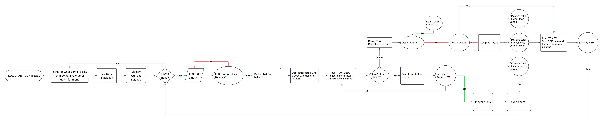

# TerminalGambling
Three gambling games playable in the terminal!

## Run Python File
You need to install the library "keyboard" to run the script.
To install, run `pip install keyboard`

To play the game, run `python3 Main.py` in the game directory.

## Code Functionality Flowcharts

## Games Included
### Horse Racing (betting)
You scroll the list of horses to bet on, and press enter on the horse you wish to bet on winning. There are different probabilities of the horses winning and higher payouts on the lower probability horses and lower on the higher probability horses. There will be “events” or things that happen in the race every second, with race commentary-like text on screen. After the race, it will display the places each horse got. You will get the payout if the horse got on the podium (top 3).

### Roulette
You to bet on the given numbers, colours, or whether it is odd or even. At the beginning you will select the category by going up or down, with the options being “numbers”, “colours”, “odd/even”, maybe more being added later. In the submenu you’ll just select the options based on what options you are presented with. The ball will appear to roll across different numbers before landing on the correct one when you play any of the options in the Roulette game.

### Blackjack
Each round, your goal is to draw cards to try get as close to 21 as possible without going over, and beat the dealer. You have to try to make as much money as possible.

## Save file & Leaderboard
It will save in json format (thats how someone on stackoverflow did it and im yoinking their code) and when you get to $0 or lower, it will just delete the save. It will ask for your name when you open the python file and load and save the amount of money assigned to that name.

Using this local save file, I will display the high score (of money) in the main menu, under the game selection part. The games have shared money so this will be the money from all three games.

#### Please note, the save file is local only. Nothing will be saved to the cloud as of now.

## Final Iteration Testing and Justification
### High Quality Justification:
My outcome is of high quality because it successfully balances functionality and usability to meet the brief of creating an engaging, terminal-based betting game. Throughout the development of the Menu, Horse Racing, Roulette, and Blackjack components, I ensured that the functionality accurately reflected real-world gambling; the money can be gained by playing, but the odds are balanced so they are slightly against the player in the long run. In terms of design and usability, the program is intuitive for the end user, utilizing a consistent menu style with arrow key navigation, debounce code to prevent input queuing, and clear instruction tabs for each game. The aesthetics and pacing werecloned significantly improved during the second iterations to build suspense and user engagement; this included adding a spinning emulation with strobing colored text in Roulette, reducing the race time in the Horse Race from 10-15 seconds to 5-8 seconds to make gameplay more repeatable, and updating the Blackjack UI so the dealer's turn plays out smoothly without manual keypresses.

In terms of design elements and accessibility, I heavily considered CRAPBS principles to ensure the terminal UI was clean, readable, and easy to navigate. I utilized Contrast by implementing specific colored text for the Roulette game to clearly indicate what color the ball landed on, and I used Alignment and Space to structure the main menus and game statistics; like the Blackjack hands and scores, so the player's eyes are naturally drawn to the most important information. Accessibility was directly addressed by adding comprehensive, easy-to-find instruction tabs for every single game, ensuring that even users entirely new to gambling understand the mechanics before playing. Furthermore, I ensured strong functionality and adherence to standard coding practices (like PEP guidelines for Python) by refining the backend. Using time.sleep() and clearing input buffers to fix input queuing and screen flickering means the program runs reliably and remains highly responsive to user inputs.

### Testing and Evidence:
The testing of my outcome provides strong evidence for this high quality, relying heavily on both functional trialing and direct end-user feedback from my playtesters, Nils, Lewis, Zach, and Sam. Functionally, I repeatedly tested the games to ensure there were no glitches, such as spamming inputs to verify the menu debounce and running the games multiple times to confirm the win/loss probability balancing. More importantly, stakeholder testing drove key usability improvements; for instance, Sam suggested adding brackets and arrows to make the Roulette winning number visually clearer, while Nils suggested having the Blackjack dealer wait 0.2 seconds between plays rather than requiring the user to press enter. Their feedback also directly shaped the Horse Race game, leading to adjusted horse probabilities and payout percentages to ensure it felt fair to the player while remaining realistic.
